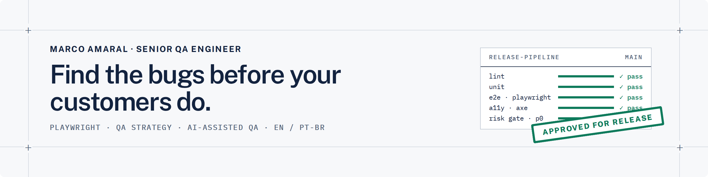

<a href="https://marcoamaral.com/?utm_source=github&utm_medium=readme">
  <picture>
    <source media="(prefers-color-scheme: dark)" srcset="assets/banner-dark.png">
    
  </picture>
</a>

<p align="center">
  <picture>
    <source media="(prefers-color-scheme: dark)" srcset="https://readme-typing-svg.demolab.com?font=IBM+Plex+Mono&weight=500&size=17&duration=2800&pause=1400&color=CFE0FF&center=true&vCenter=true&width=640&lines=%E2%80%BA+QA+strategy%3A+what+to+test+and+when+to+ship;%E2%80%BA+Playwright+automation+your+team+will+run;%E2%80%BA+QA+audits+with+a+prioritized+bug+report;%E2%80%BA+Migration+from+Cypress+or+Selenium">
    
  </picture>
</p>

## Hi, I'm Marco

**Senior QA Engineer** with 8+ years in software testing. I help product teams find the bugs before their customers do. I build the QA system around a product, not just the tests:

- **QA strategy:** what to test, how deep, and when it's safe to ship (risk register, traceability, release gates)
- **Playwright automation** your developers will actually run, with accessibility checks and CI
- **QA audits:** exploratory testing by a senior tester, with a prioritized bug report
- **Migration** of slow or flaky Cypress and Selenium suites to Playwright

## Open source

**[QA Instinct](https://github.com/MarcoAmaral/qa-instinct)** gives AI coding assistants (Claude Code, Cursor, Copilot and others) the knowledge of a Senior QA Engineer: test design, test cases, Playwright automation, defect reports and release checks.

```bash
npx qa-instinct init
```

## Recent work

| Kaffa Tech | SWARECO | POWR.io |
|---|---|---|
| **QA system for a GIS utility-network editor**, built from zero | **Contract QA on a solar-loan servicing platform** | **Launch after launch on a SaaS platform** |
| 30 risks scored · 181 test cases traced to 43 user stories · 5 defects found before testing began | Go/no-go criteria for every release · a Playwright regression test for every fixed bug | 60+ website apps · used on over 12 million websites |

Read the case studies at **[marcoamaral.com](https://marcoamaral.com/case-studies/?utm_source=github&utm_medium=readme)**.

## Tools

`Playwright` `TypeScript` `Cypress` `Postman` `axe-core` `GitHub Actions` `Azure DevOps` `Jira` `Claude Code`

## Work with me

Available for contract and freelance QA work, remote, in English or Portuguese.

[](https://marcoamaral.com/contact/?utm_source=github&utm_medium=readme)
[](https://marcoamaral.com/?utm_source=github&utm_medium=readme)
[](https://www.linkedin.com/in/marco-amaral-qa/)
